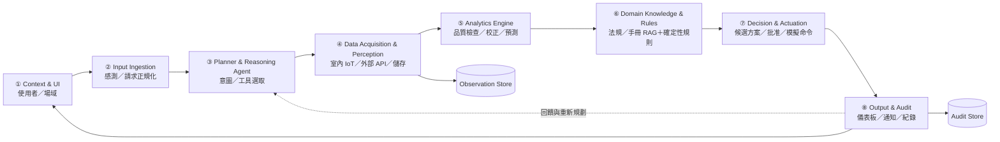
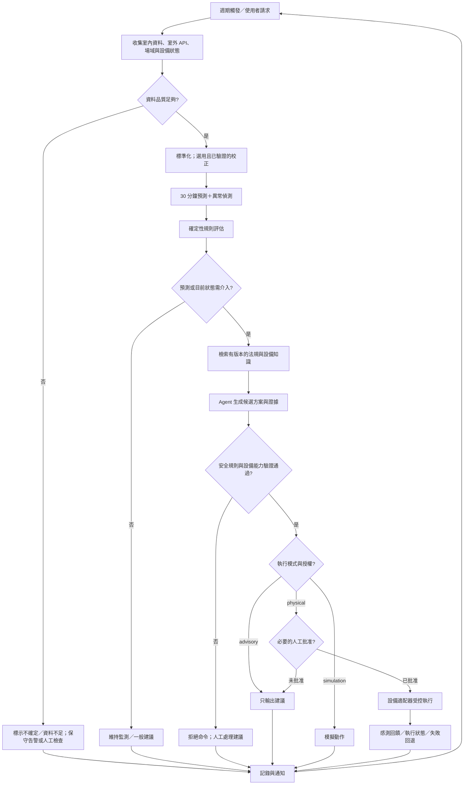

# AirGuard AI — System Design Document

> **專案名稱**：AirGuard AI — A Proactive Indoor Air Quality Protection Agent Integrating IoT Sensor Streams and Domain Knowledge  
> **文件版本**：v0.1.0（Proposal Baseline）  
> **文件日期**：2026-11-13  
> **狀態**：**Proposed / Not yet implemented**  
> **用途**：作為 GitHub `DESIGN.md`、OpenSpec 規格拆分與後續實作驗收的單一設計基準。  
> **證據邊界**：依照目前《AirGuard AI 提案草稿》、A2Z SOP 與期末專題規範整理。文中的技術選型、閾值、性能目標均屬規劃；未標示已執行的測試或實驗結果。法規、引用文獻、資料服務與 API 使用條件需在實作前再次核對。

---

## 0. Document Control / 設計狀態

| 欄位 | 設計基準 |
|---|---|
| Project Type | IoT + Domain AI Agent + Data Analytics + Real-World Application |
| Primary Scenario | 室內空氣品質監測、短時預測、風險預警與設備調控建議 |
| MVP Boundary | **先以監測＋預測＋可解釋建議＋模擬設備指令** 完成閉環；真實設備控制另需安全核准 |
| Key Inputs | 室內 PM2.5 / CO2 / TVOC（若感測器具備）、溫度、相對濕度；室外空品資料、場域設定 |
| Key Outputs | 資料品質註記、短時趨勢、警報、建議行動、可追溯證據、歷史紀錄 |
| Quantitative Targets | 預警前置時間 ≥ 30 分鐘、超標累積時間下降 ≥ 40%：**提案目標，不是成果** |
| Lifecycle | Requirements → Design → Implementation → Verification → Evaluation → Handover |
| Principle | 可重現、可解釋、失效安全、人工可覆核；數值判定不得由 LLM 任意決定 |

### 0.1 Terminology

- **IAQ**: Indoor Air Quality，室內空氣品質。
- **PM2.5**: 細懸浮微粒質量濃度。
- **CO2**: 二氧化碳，常作為通風狀態的間接參考，並非所有污染風險的充分指標。
- **TVOC**: 總揮發性有機化合物，量測定義與感測器類型必須標註。
- **RAG**: Retrieval-Augmented Generation，檢索環境／法規／設備手冊，供回應引用。
- **Agent**: 依任務選取工具、整合證據及生成行動計畫的協調層。
- **DCF**: 提案中提到的動態校正濾波流程（名稱為工作代號，具體方法待驗證）。
- **HITL**: Human-in-the-Loop，人員覆核或批准。
- **Simulation Mode**: 模擬設備命令與環境變化，不直接控制實體設備。

## 1. Problem → Goals → Non-goals

### 1.1 Problem Statement

既有空氣品質監測經常將工作停在「顯示數據或超限通知」。在室內污染來源、外部空氣品質、人流與通風方式同時變動時，單一閾值難以直接導出恰當的處置。低成本感測器還可能受濕度、漂移、離線與取樣差異影響。AirGuard AI 希望將 **環境感知 → 數據品質檢查 → 短時預測 → 規則與知識查詢 → 行動評估 → 人員可理解的回應／受控執行 → 回饋紀錄** 串成可驗證流程。

### 1.2 Goals

- **G-01 可信感知**：收集並保存室內／室外空品資料，包含時間戳、單位、位置、來源和品質標記。
- **G-02 資料品質**：對缺值、異常跳變、離線、時間不同步和可能的濕度影響做明確處理。
- **G-03 短時分析**：輸出可量化、可重現的未來 30 分鐘污染物濃度預測及不確定性描述。
- **G-04 領域約束**：依適用場域、量測平均時間與有效版本的標準執行規則判定。
- **G-05 可解釋決策**：提供警報、候選處置方案、理由、資料依據及風險限制。
- **G-06 安全控制**：模擬階段提供設備命令；實體控制必須經過範圍限制、權限管理與故障回退。
- **G-07 評估與交付**：比較預測模型及控制策略，保留實驗設定、結果和可重現操作文件。

### 1.3 Non-goals（目前不納入 MVP）

- 不進行醫療診斷或個人疾病風險診斷。
- 不宣稱低成本感測器可替代法定標準檢測儀器。
- 不在未測試、無人工授權時直接操控建築關鍵 HVAC／消防／安全設備。
- 不以 LLM 生成的數值取代感測、標準公式、已訓練模型或規則引擎。
- 不將「符合室外空氣品質標準」等同於「取得室內場域自主管理標章」。
- 不在 MVP 階段承諾即時壓差量測、完整 CFD 模擬或多場域泛化能力；除非另行提供硬體與資料。

## 2. Users, Scenarios & Functional Requirements

### 2.1 Actors

- **Facility Manager**：查看風險、確認或拒絕高影響設備建議、查閱事件紀錄。
- **Occupant**：查詢目前空品、風險原因與建議行動。
- **Researcher / Developer**：管理資料集、模型、配置、測試與實驗。
- **IoT Device / External Data Provider**：提供環境觀測值。

### 2.2 Core User Stories

- **US-01**：作為使用者，我可以詢問「目前教室空氣品質如何？」並看到時間、數據、品質與來源。
- **US-02**：作為管理員，我可以知道未來 30 分鐘 PM2.5／CO2 是否可能越過設定的運作門檻。
- **US-03**：作為管理員，我可以理解建議「維持過濾、增加經過處理的外氣、要求現場檢查」各自的依據。
- **US-04**：作為管理員，我可以在高風險控制動作執行前進行核准；系統可以拒絕不安全指令。
- **US-05**：作為研究者，我可以重現預測、告警與控制策略的實驗比較。

### 2.3 Functional Requirements（OpenSpec 拆分依據）

| ID | Requirement | Acceptance / 驗收條件 |
|---|---|---|
| **FR-001** | 室內感測資料匯入 | 每筆記錄含 `sensor_id`, `site_id`, `timestamp`, `metric`, `value`, `unit`, `quality_flag`；資料不合法拒收或隔離 |
| **FR-002** | 室外 API 匯入 | 擷取結果記錄供應商、測站／位置、抓取時間、測值時間；API 失效時標記 stale |
| **FR-003** | 資料標準化 | 單位和時區統一，原始值與轉換值可追溯，不可默默覆蓋原始資料 |
| **FR-004** | 資料品質管線 | 對缺值、超範圍、異常跳變、來源失效有可測試的標記與處理策略 |
| **FR-005** | 短時預測 | 以事前定義的輸入窗產出未來 30 分鐘預測，提供模型版本與產生時間 |
| **FR-006** | 法規／運作規則 | 每個閾值有污染物、值、單位、平均時間、場域、適用範圍、來源及版本 |
| **FR-007** | 風險判定 | 規則引擎輸出風險等級、觸發規則、輸入證據；不得只依 LLM 回答判定 |
| **FR-008** | 領域文件檢索 | RAG 回傳文件標題、版本、段落與出處；找不到可信來源時明確說明 |
| **FR-009** | Agent 策略 | 依風險、資料品質、設備能力和授權選擇「建議／觀察／模擬／提交批准」 |
| **FR-010** | 設備命令防護 | 命令須 schema 驗證、權限檢查、可用範圍與互斥規則驗證；MVP 預設不真實下發 |
| **FR-011** | Dashboard & 對話 | 呈現實測與預測的區別、告警依據、建議、不確定性、更新時間 |
| **FR-012** | 審計日誌 | 記錄觸發原因、資料版本、模型版本、檢索證據、決策、批准、命令與結果 |
| **FR-013** | 降級運行 | 無網路／來源 stale／感測器無效時，不以舊資料做未註記的即時保證或危險自動控制 |
| **FR-014** | 實驗重現 | 固定資料區間、切分策略、隨機種子、模型參數、程式版本與指標定義 |

## 3. System Architecture（八大模組）



> 圖中的箭頭是概念資料流；實作可由排程器驅動週期性監測，並由使用者請求觸發臨時分析。Agent 不應作為不可中斷的實時安全控制器。

| Module | Responsibilities | Input → Output |
|---|---|---|
| **M1 Context & UI** | 場域配置、使用者問題、管理權限與展示 | Site config / user intent → query/context |
| **M2 Input Ingestion** | 消息格式驗證、時區與單位正規化 | MQTT/HTTP/API payload → normalized events |
| **M3 Planner & Agent** | 任務分解、工具選取、回應與方案說明 | Intent + available tools → tool plan / response draft |
| **M4 Data Acquisition** | 室內 IoT、LASS、MOENV/OpenAQ、歷史紀錄 | Source request → timestamped observations |
| **M5 Analytics** | 資料品質、可選校正、時序預測、異常偵測 | Clean window → prediction / anomaly evidence |
| **M6 Knowledge & Rules** | 法規版本管理、RAG、風險規則、設備規範 | Measurements / context → grounded constraints |
| **M7 Decision & Actuation** | 候選方案、權衡、安全閘、HITL、模擬／受控命令 | Constraints + forecast → approved/simulated action |
| **M8 Output & Audit** | 警報、圖表、來源、決策追溯、事件紀錄 | Evidence + decisions → UI / log / report |

### 3.1 Proposed Technical Stack（待選型，非已安裝）

- Python 3.11+；FastAPI（API）與 Streamlit（MVP Dashboard），或同級替代方案。
- MQTT broker（例如 Mosquitto）／HTTP Webhook：IoT 接入方式需配合實際硬體。
- SQLite（單機 MVP）→ PostgreSQL / TimescaleDB（多場域擴展）。
- Pandas、scikit-learn；LightGBM 作為候選主模型，LSTM 作為實驗比較。
- LLM provider / local model 與 tool-calling adapter；Agent framework **選用**，不依賴特定商業模型名稱。
- ChromaDB/其他向量儲存作為 RAG 候選；實際安全規則另存結構化設定，不讓向量檢索決定控制閾值。
- Docker / Docker Compose、pytest、GitHub Actions 可作開發與驗證工具。

## 4. Data Architecture & Contracts

### 4.1 Source Strategy

| Source | Proposed Purpose | Key Caveat |
|---|---|---|
| 室內 IoT 感測器 | 室內現況及控制回饋 | 硬體型號、校正與讀值頻率未定；須自行記錄 |
| MOENV 公開資料 | 室外測站數據及基準參考 | API 條款、測站距離、時間粒度需確認；非室內真值 |
| LASS / AirBox | 高空間密度的室外微型感測觀測 | 低成本感測器品質、取得方式與 DCF 欄位需核對 |
| OpenAQ | 跨區域資料研究（選用） | 地區覆蓋、授權、更新頻率需核對 |
| 主管機關法規／室內空品指引 | 閾值依據與安全解釋 | **室內／室外標準及平均時段必須分開** |
| 設備手冊 | 命令能力、運作限制與安全範圍 | 必須對應實際設備型號與韌體版本 |

### 4.2 Minimal Data Schemas（建議）

```yaml
Observation:
  observation_id: uuid
  site_id: string
  sensor_id: string
  source: indoor_iot | moenv | lass | other
  observed_at: ISO8601_with_timezone
  ingested_at: ISO8601_with_timezone
  metric: pm25 | pm10 | co2 | tvoc | temperature | humidity | other
  value: number
  unit: string
  quality_flag: valid | suspect | missing | stale | invalid
  raw_reference: string

Forecast:
  forecast_id: uuid
  site_id: string
  target_metric: pm25 | co2
  issued_at: ISO8601_with_timezone
  target_at: ISO8601_with_timezone
  horizon_minutes: 30
  predicted_value: number
  predicted_unit: string
  model_name: string
  model_version: string
  interval_low: number | null
  interval_high: number | null
  input_data_quality: string

DecisionRecord:
  decision_id: uuid
  site_id: string
  issued_at: ISO8601_with_timezone
  risk_level: normal | watch | warning | critical | unknown
  trigger_rule_ids: [string]
  evidence_observation_ids: [uuid]
  evidence_forecast_ids: [uuid]
  retrieved_document_refs: [string]
  candidate_actions: [object]
  selected_action: object | null
  approval_status: not_required | pending | approved | rejected
  execution_mode: advisory | simulation | physical
  execution_status: not_executed | simulated | executed | failed
```

### 4.3 Data Quality

- 所有時間戳保留原始時區，內部建議統一 UTC，介面顯示當地時間。
- 對齊不同採樣頻率時，記錄 resampling 方法及資料覆蓋率。
- 若室內 CO2、TVOC 沒有真實感測器，不能用室外 PM2.5 開放資料代替室內 CO2／TVOC 真值。
- 不允許未經評估的「附近官方測站值直接校正室內感測器」；因室內外微環境不一致。
- **DCF 是待驗證子任務**：先保留 raw/corrected 欄位，透過共同位置與時間的參考量測驗證偏差，避免資料洩漏。
- 異常讀值應分為 `sensor_fault_suspected` 和 `pollution_event_suspected`，不得視為同一事件。

## 5. Analytics & Domain Knowledge

### 5.1 Forecasting

- **預測目標**：以室內 PM2.5 作第一階段核心；CO2 預測以實際取得的室內感測記錄為前提。
- **預測步長**：30 分鐘（proposal）；若採樣每 5 分鐘，對應多步 ahead 或直接 horizon 預測，須記錄定義。
- **Baseline**：Persistence（上一個有效值）、季節性／簡單統計模型、規則式預警；LSTM 作為候選比較。
- **Candidates**：LightGBM / LSTM。應以實際資料量、時間與效能決定選型。
- **Evaluation**：MAE、RMSE，並依一般時段／突發事件／來源缺失分組報告。
- **Uncertainty**：可先用歷史殘差或 quantile 模型產生經驗範圍；未做校準前不得稱為具覆蓋率保證的信賴區間。

### 5.2 Physical Domain Model（簡化通風模型；非已校正）

可用單區均勻混合近似模型作為設計與模擬起點：

\[
\frac{dC_{in}}{dt}=\frac{G}{V}+\frac{Q}{V}(C_{out}-C_{in})-k_{rem}C_{in}
\]

其中 \(C_{in}\) 為室內濃度、\(C_{out}\) 為室外濃度、\(G\) 為室內污染物生成率（質量／時間）、\(V\) 為空間體積、\(Q\) 為換氣量（體積／時間）、\(k_{rem}\) 為等效移除係數（1／時間）。此為概念模型：不同污染物的生成、沉降、過濾與通風機制需要分別估計。**若缺乏必要量測，不得宣稱可控制壓差或精確推估 ACH。**

### 5.3 Rules & Knowledge: Keep Distinct

- **Deterministic Rule Engine**：執行正式可稽核的數值判斷，例如指定污染物、平均時間、適用場域和管理閾值；規則有版本。
- **RAG Knowledge Base**：檢索室內空氣品質規範、通風與設備手冊，用於提出理由和候選方案。
- **LLM Agent**：以結構化工具輸出組織敘述、比較方案；不能修改安全界限或偽造證據。
- **Standards Governance**：提案引用的 2024 年室外空氣品質標準數值及室內自主管理等級**不得直接混成單一控制閾值**。正式執行前要建立 `rules_catalog.yaml`，逐項查證來源、適用條款、平均時間與生效日期。

### 5.4 Decision Objective（研究用；權重未定）

候選策略需先滿足硬性安全限制，再比較污染暴露代理指標、能耗、設備頻繁切換與人員舒適：

\[
\min_{a \in \mathcal{A}_{safe}} J(a)=w_1E_{pollution}(a)+w_2E_{energy}(a)+w_3N_{switch}(a)+w_4D_{comfort}(a)
\]

`w_i`、各項尺度與 `A_safe` 均須由場域設備與模擬實驗定義；此式是候選評估架構，不是已實作的最佳化控制器。

## 6. Agent Workflow & Safety Gates

### 6.1 Execution Flowchart



### 6.2 Pseudocode — Algorithm 1

```text
Algorithm 1: AirGuard Reasoning & Safety Cycle
Input : indoor_stream, outdoor_sources, site_config, device_registry, user_request?
Output: risk_report, recommendation, optional validated_action, audit_record
01  trigger <- scheduler_event or user_request
02  context <- load_site_config_and_permissions(trigger)
03  raw <- ingest_available_sources(indoor_stream, outdoor_sources)
04  observations <- normalize_and_validate(raw)
05  quality <- check_freshness_missingness_outliers(observations)
06  if not quality.sufficient:
07      return explain_unknown_and_log_safe_fallback(quality)
08  clean <- apply_verified_calibration_if_configured(observations)
09  forecast <- predict_horizon(clean, minutes=30, model_version=active_model)
10  risk <- evaluate_versioned_rules(clean, forecast, context)
11  if risk.is_normal:
12      return report_and_audit(clean, forecast, risk, action='monitor')
13  evidence <- retrieve_applicable_docs(risk, context, device_registry)
14  candidates <- agent_propose_actions(risk, forecast, evidence, context)
15  validated <- filter_by_rules_permissions_and_device_limits(candidates)
16  if validated is empty:
17      return request_human_review_and_audit(risk, evidence)
18  action <- rank_safe_candidates(validated, configured_objectives)
19  if context.execution_mode == 'advisory':
20      status <- recommend_only(action)
21  else if context.execution_mode == 'simulation':
22      status <- simulate(action)
23  else if context.execution_mode == 'physical':
24      status <- execute_only_if_approved(action, interlocks, timeout)
25  else:
26      status <- deny_unknown_mode()
27  audit <- record_inputs_model_rules_evidence_approval_and_status()
28  return report_with_sources_uncertainty_and_actions(audit)
```

### 6.3 Safety Policy

- **Safe by default**：`execution_mode: advisory`；`simulation` 是 MVP 可用模式，`physical` 預設停用。
- **Authority Boundary**：LLM 只提出命令候選，控制適配器依設備能力、保護邏輯與角色權限決定是否可執行。
- **Hard constraints**：指令範圍、切換頻率、最短運轉／停機時間、互斥控制、逾時回退、緊急停止。
- **Human approval**：高影響 HVAC、外氣切斷、全場域警報或策略更動須事前明定批准方式。
- **Missing evidence**：法規來源失效、sensor stale、模型缺乏有效輸入時，應顯示未知／需人工確認，而不是宣稱合規。
- **Privacy / security**：場域資訊與設備憑證不得寫入公開 Repo；API key 以環境變數或 secrets 管理；最小權限。

## 7. Evaluation Plan（Proposal，尚未執行）

### 7.1 Dataset & Split

1. **Indoor log**：目標蒐集約 3 個月室內感測日誌；是否能達成取決於實際感測器部署。
2. **Outdoor context**：對應時段的 MOENV／LASS 資料；缺值與來源距離均需要記錄。
3. **Split**：採時間序列切分，規劃 70% train、15% validation、15% test，**不能隨機打亂未來與過去**；跨站點泛化另以留站測試。
4. **No leakage**：任何 scaler、校正參數、視窗工程和模型選擇只使用訓練／驗證允許的資料。

### 7.2 Metrics & Baselines

| ID | Evaluation | Baseline / Comparator | Metric |
|---|---|---|---|
| **EV-01** | 室內 PM2.5（可選 CO2）預測 | Persistence、統計方法、LSTM / LightGBM 比較 | MAE、RMSE、分情境誤差 |
| **EV-02** | 預警能力 | 現況閾值告警 vs. 預測告警 | Lead Time、Precision、Recall、False Alarm Rate |
| **EV-03** | 控制／建議效果 | Rule-based baseline vs. AirGuard policy（**相同模擬環境**） | 超標累積時間、暴露代理指標、能耗代理指標、切換次數 |
| **EV-04** | 知識／規則可信度 | 無 RAG、無規則防護的受控對照 | 引用支持率、違規命令率、專家一致性 |
| **EV-05** | 失效韌性 | API 失聯、sensor drift、缺值、異常高值 | 降級正確率、誤報、未授權命令數 |
| **EV-06** | 使用者可理解性 | 簡易規則告警 vs. 含說明的 Agent | 任務完成率、Likert 評分、回應時間 |

### 7.3 Targets and Evidence Status

| Proposal Target | Current Status | Verification Needed |
|---|---|---|
| **≥ 30 分鐘預警前置時間** | Target only | 需定義事件起點、預警時間、提前與誤報計算方式 |
| **≥ 40% 超標時長下降** | Target only | 需可比較的控制環境與相同外生條件 |
| **合規與可解釋防護** | Target only | 需正確場域標準、專家審查規則與版本記錄 |
| **避免室外污染導致二次污染** | Hypothesis | 需控制策略與室外條件的對照測試 |

> 草稿中出現的「86% 控制準確率」「12.8% 節能」「85% 避免二次污染」等數據，**尚未完成來源核驗，不得作為本系統結果或已確認的文獻結論**。

## 8. Implementation Mapping & Repository Layout

下列為**建議的目標結構**，不是現有檔案清單。

```text
AirGuard-AI/
├── README.md
├── DESIGN.md
├── openspec/                  # 依實際 openspec init 產生的結構為準
├── configs/
│   ├── app.example.yaml
│   ├── rules_catalog.example.yaml
│   └── devices.example.yaml
├── data/                      # 原始敏感／大型資料不直接提交
│   └── README.md
├── docs/
│   ├── data_sources.md
│   ├── safety_policy.md
│   └── evaluation_protocol.md
├── src/airguard/
│   ├── ingestion/
│   ├── quality/
│   ├── forecasting/
│   ├── knowledge/
│   ├── agent/
│   ├── rules/
│   ├── decision/
│   ├── actuation/
│   ├── storage/
│   └── api/
├── app/                       # Dashboard
├── experiments/
├── tests/
├── scripts/
├── requirements.txt          # 或 pyproject.toml
└── .github/workflows/
```

| Module | Suggested Code Area | First Test |
|---|---|---|
| M2 / M4 | `ingestion/`, `storage/` | 新舊時間戳、缺欄位和 API 失敗 |
| M5 | `quality/`, `forecasting/` | 時間洩漏、預測維度、資料缺失 |
| M6 | `rules/`, `knowledge/` | 規則適用條件、錯版條文、檢索引用 |
| M3 / M7 | `agent/`, `decision/`, `actuation/` | 未授權命令拒絕、錯誤回退、模擬執行 |
| M1 / M8 | `api/`, `app/`, `storage/` | 來源標示、預測／實測區分、審計可追蹤 |

## 9. OpenSpec Migration Blueprint

> `DESIGN.md` 是長期維護的整體架構基準；OpenSpec 將其拆成**可審查、可驗收的能力規格與變更提案**。請先在本機 Repo 執行你安裝版本支援的 `openspec init`／help，實際工作目錄以 CLI 產生結果為準。

### 9.1 Capability Boundaries（建議 Specs）

| Spec ID | Suggested Capability | Source Requirements |
|---|---|---|
| **SPEC-01** | `sensor-ingestion` | FR-001, FR-002, FR-003 |
| **SPEC-02** | `data-quality` | FR-004, FR-013 |
| **SPEC-03** | `air-quality-forecasting` | FR-005, FR-014 |
| **SPEC-04** | `domain-rules-and-rag` | FR-006, FR-007, FR-008 |
| **SPEC-05** | `agent-planning-and-safety` | FR-009, FR-010 |
| **SPEC-06** | `dashboard-and-audit` | FR-011, FR-012 |
| **SPEC-07** | `evaluation-protocol` | FR-014 + EV-01~EV-06 |

### 9.2 Proposed First Change

**Change name:** `bootstrap-airguard-observability`  
**Why:** 先建立可追溯的資料流與品質標記，讓後續預測和 Agent 的輸入有可驗證基礎。  
**Scope:** FR-001~FR-004；最小資料庫、基本狀態頁面、單元測試。  
**Out of scope:** 真實 HVAC 控制、法規自動處置、LLM 自主命令。  
**Definition of Done:** 能匯入測試資料、標準化欄位、拒收不合法值、顯示資料來源與更新時間、測試通過。

### 9.3 Suggested Change Sequence

1. `bootstrap-airguard-observability` — 感測與資料品質。
2. `add-versioned-domain-rules` — 來源與版本明確的規則引擎。
3. `add-forecasting-baselines` — Persistence 與第一個 ML 預測模型。
4. `add-grounded-agent-recommendations` — 工具呼叫、RAG、解釋與引用。
5. `add-simulated-actuation` — 驗證命令 schema、安全閘與模擬控制。
6. `add-experiment-suite` — 可重現比較、消融與報告。
7. `enable-authorized-physical-actuation` — **獨立的未來變更**，須完成安全審查和真實設備測試。

### 9.4 Spec Writing Rules

- 每項要求寫成可測試語句（例如 `SHALL`），並包含正常、異常與安全邊界情境。
- 每項變更清楚記錄：**Why / Scope / Requirements / Design / Tasks / Acceptance Tests**。
- `DESIGN.md` 保留跨模組決策與資料流；OpenSpec 描述某項能力的具體行為和驗收條件。
- 只有在測試通過、設計與文件一致後，才將對應變更標記完成／歸檔。

## 10. Risks, Assumptions & Open Decisions

### 10.1 Key Risks

| Risk | Impact | Mitigation |
|---|---|---|
| 室內監測數據不足 | 無法驗證真正的室內預測及控制 | 先定義蒐集方案；不足時只完成室外資料演示，不虛稱室內效果 |
| 法規引用與平均時間混淆 | 錯誤告警／不當合規聲明 | Versioned rule catalog + 來源人工核對 |
| 感測器漂移與濕度干擾 | 假陽性、錯誤控制 | 品質旗標；共同位置參考校正；異常隔離 |
| LLM 幻覺或命令越權 | 錯誤設備操作 | Deterministic safety gate + HITL + 預設 advisory |
| 模型資料洩漏 | 不實的預測績效 | 時序切分、訓練內校正、獨立 test |
| 不能控制實體設備 | 無法測真實控制效果 | 同條件 simulator；控制結果僅宣稱模擬評估 |
| 外部 API 中斷 | 缺資料 | Stale handling + safe fallback |
| 來源／論文引用不完整 | 報告可信度不足 | 原始文件查證、文獻比對表與引用清單 |

### 10.2 Open Decisions（需由團隊確認）

- **OD-01**：實際場域是教室、辦公室、宿舍或其他？空間體積與人流可否取得？
- **OD-02**：已具備哪些室內感測器？PM2.5、CO2、TVOC、溫濕度採樣頻率各是多少？
- **OD-03**：是否有可控設備？型號、控制協定、授權方式、保護限制為何？
- **OD-04**：是否已蒐集室內歷史數據？能否持續取得 3 個月？
- **OD-05**：優先污染物、預測步長和系統取樣週期是否採本版預設？
- **OD-06**：執行平台是 Ubuntu 主機、Raspberry Pi、Docker、雲端或組合？
- **OD-07**：所引用法規是否適用此場域？主管機關與正式版本如何保存？
- **OD-08**：期末只做模擬閉環，或有設備安全測試資源能擴至實體？
- **OD-09**：LLM 服務選型、延遲、費用與離線需求？

> **不必在開始寫 OpenSpec 前回答全部 OD。** 第一個變更可採用模擬資料和 advisory mode，後續逐項決策並更新本文件。

## 11. Milestones & Definition of Done

| Milestone | Scope | Evidence to Deliver |
|---|---|---|
| **M0** | Repository / OpenSpec / 設計基準 | README、DESIGN.md、規格提案、開發環境 |
| **M1** | Ingestion & Data Quality | 最小資料庫、可測試接入、資料品質報表 |
| **M2** | Rules & Knowledge | 版本化規則、RAG 引用測試、法規核對清單 |
| **M3** | Forecasting | 時序切分、Baseline、MAE/RMSE、重現腳本 |
| **M4** | Agent & Safe Recommendation | 工具選取、風險判斷、安全閘與審計測試 |
| **M5** | Simulated Closed-loop | Rule-based vs Agent 的相同場景比較 |
| **M6** | Final Evaluation & Handover | Results、限制、Final PPT、Demo 影片、完整文件 |

**Done means**：程式可執行、功能有測試、假設與來源有記錄、錯誤情境有定義、所有數據結果可重現、README 與 DESIGN.md 更新。

## 12. Research Framing (A2Z / Course Alignment)

- **Abstract A–F**：Motivation → Challenge → Proposed Agent → IoT/Analytics/RAG method → Planned evaluation → Expected outcomes。
- **Introduction G–L**：General → However → In literature → Judgement → Keypoint → Organization。
- **Related Work M–O**：AI technology（時序預測／Agent）＋ Domain know-how（污染物／通風／法規）＋方法比較矩陣。
- **Deep Research**：五個核心思維（質量平衡、暴露時間、感測漂移、氣流壓差、健康／能耗權衡）；三項爭論（過濾 vs 通風、微型感測器可信度、自主 vs HITL）；十個 Why/What-if/Trade-off/Failure/Evidence 問題。
- **Proposed Scheme PA–PM**：目標、模組、數學模型、架構圖、互動流程、Pseudocode、實驗設計。
- **Simulation Q–V**：資料、Baseline、參數、結果、驗證。
- **Conclusion W–Z**：貢獻、適用範圍、實驗結果、限制與未來工作。

## 13. Traceability & Source Verification

### 13.1 Current Input Documents

- 《AirGuard AI 提案草稿》（使用者提供 Markdown）：概念、八模組、實驗目標、候選文獻與資料來源。
- 《期末專題提案作業規範》：Domain AI Agent、Abstract／Introduction／Related Work／Deep Research／Proposed Scheme、Architecture／Flowchart／Pseudocode、GitHub + DESIGN.md。
- 《A2Z outline example》：A–Z 章節與研究流程。

### 13.2 External Sources Proposed for Verification（未在本 DESIGN.md 中完成核驗）

- Taiwan MOENV 空氣品質標準／室內空氣品質管理相關正式法規文本。
- MOENV 空品資料開放平台、LASS/AirBox、OpenAQ API 文件與授權。
- ASHRAE 62.1 適用範圍、版本與可取得條款。
- 原稿提及 arXiv:2609.05314、arXiv:2512.25055 及其他控制／校正研究：核對書目、年份、實驗設定與數字。

**Important:** 提案中有引用「2024/2025 法規／論文指標」與研究效益數值，但本設計文件不將其視為已確認的控制閾值或實驗成果。實作法規相關判定前必須建立可查證的規則清單。

---

## Appendix A — Example Scenario

**Situation**：教室內 CO2 有逐漸升高趨勢，室外 PM2.5 亦偏高。  
**AirGuard process**：確認資料時效與品質 → 預測室內 CO2 趨勢 → 判斷場域運作門檻 → 檢索可用通風設備與相關規範 → 比較「提高經過過濾的外氣」「調整清淨機」「提示人員檢查」等可行方案 → 在安全閘與授權內產生解釋及模擬命令 → 記錄回饋。  
**Interpretation guardrail**：清淨機對 PM2.5 可有幫助，但一般顆粒過濾並不能直接解決 CO2；外氣品質差也不代表應全面停止所需通風，需依實際 HVAC 能力與安全要求評估。

## Appendix B — Change Log

| Version | Date | Change |
|---|---|---|
| v0.1.0 | 2026-11-13 | 首次提案設計基準；對齊課程規範並加入 OpenSpec 拆分、資料契約、安全閘與實驗規劃 |
