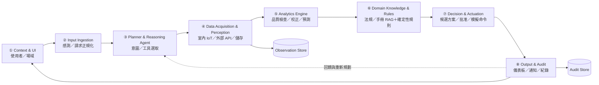
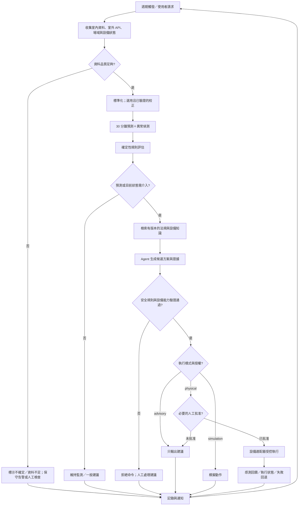

# AirGuard AI: A Proactive Indoor Air-Quality Protection Agent

> **Document status:** Research proposal; proposed system, not implemented. No AirGuard experiment has been run.
> **Source of system requirements:** The repository's `DESIGN.md`, which remains unchanged.
> **Evidence boundary:** The targets below are plans, not findings. Literature statements are attributed to the cited source and limited to material checked for this draft.

## Abstract

### A. Attention Getter

Indoor-air management is a time-dependent decision problem: measurements, pollutant sources, occupancy, ventilation, and outdoor conditions may change on different schedules. A useful system should therefore do more than display a reading; it should preserve when and where a measurement was made, whether it is trustworthy, and what evidence supports a proposed response.

### B. Challenge

An alert based on a single threshold does not by itself identify an appropriate action. Sensor drift, missing or delayed readings, pollutant-specific behavior, indoor/outdoor differences, and standards with different scopes or averaging periods can all limit interpretation. Acting on an uncertain estimate may be as problematic as missing an emerging condition.

### C. Cure

This proposal introduces AirGuard AI, a planned indoor-air-quality decision-support system that connects IoT observations, data-quality checks, short-horizon forecasting, versioned deterministic rules, domain-document retrieval, and explainable recommendations. A language model may organize evidence and candidate actions, but it will not determine numeric thresholds or bypass safety rules.

### D. Development

The proposed system follows the eight-module architecture in `DESIGN.md`: context and UI; input ingestion; planner and agent; data acquisition; analytics; domain knowledge and rules; decision and actuation; and output and audit. The MVP boundary is monitoring, forecasting, explanation, and simulated device commands. Physical HVAC control is outside scope. Candidate technologies and integrations remain subject to hardware, data-access, and source verification.

### E. Experiments

Evaluation is planned with indoor observations if they become available, matched outdoor context where appropriate, chronological train/validation/test splits, and declared persistence and statistical baselines. Forecast metrics will include MAE and RMSE; warning evaluation will define event onset, lead time, precision, recall, and false-alarm rate. Policy comparisons will use a shared simulation environment and report exceedance duration and energy proxies. None of these experiments has been conducted.

### F. Expected Findings

The study will test whether a provenance-aware workflow can provide useful warnings and whether simulated, constrained recommendations can improve on declared baselines under comparable conditions. The design's target of at least 30 minutes' warning lead time and at least 40% lower exceedance duration are hypotheses/targets only. Outcomes may be neutral or negative; no result is asserted in this proposal.

## 1. Introduction

### General (G)

Indoor-air decisions depend on observations in a particular room, at a particular time, for a particular pollutant. A field study in nine university classrooms measured particle mass, particle number, and CO2 while examining ventilation and filtration configurations [1]. Such measurements describe sampled conditions and intervention effects in those rooms; they do not themselves provide a future estimate or select a response. AirGuard's proposed data contract therefore retains site, sensor, timestamp, metric, unit, source, and quality status.

### However (H)

A conventional monitor or threshold alert can identify an observed condition, but its result is limited by the sensor, sampling interval, location, data freshness, and the threshold's pollutant and averaging-time scope. A sensor-calibration review documents cross-sensitivity, external influences, and degradation over time for low-cost outdoor monitors; those findings are a reason to preserve quality and provenance, not proof that every indoor sensor has the same error [5]. A forecast adds a future estimate but does not establish that its inputs are trustworthy or that a proposed intervention is safe. Indoor and ambient guidance also have distinct scopes: the WHO indoor publication addresses selected indoor pollutants, while its global air-quality guidelines address listed ambient pollutants [7, 8].

### In literature (I)

The primary studies summarized below cover complementary but different tasks. Singh et al. compare eight machine-learning models for pollutant prediction using the GAMS dataset, although only the author abstract was accessible for this review [2]. Aldekheel et al. report field measurements of ventilation and particle filtration in classrooms [1]. Lee et al.'s peer-reviewed JARVIS work grounds HVAC question answering in sensor data and expert-curated answers [3]. He and Jazizadeh evaluate a building-energy agent on four residential energy datasets; their 2025 arXiv manuscript is a preprint, not peer-reviewed evidence [4]. Neubauer et al.'s 2026 arXiv manuscript is a review preprint, not a primary study; its synthesis reports limited deployment evidence in its HVAC corpus [6]. These sources inform the proposal but do not validate AirGuard.

### Judgment (J)

The three limitations are distinct. **Monitoring** describes sampled conditions and can miss changes between measurements or misrepresent them when data are stale or suspect; a threshold alert does not explain which available response is appropriate. **Short-horizon forecasting** estimates future values and can be evaluated against held-out data, but forecast accuracy alone neither establishes rule applicability nor chooses a safe physical action. **AI-assisted decision support** can interpret questions and retrieve context, but an unconstrained chatbot is not a measurement-quality gate, a versioned numeric rule engine, or a device safety controller. The JARVIS study demonstrates a context-grounded HVAC QA architecture, while the He and Jazizadeh preprint evaluates energy-management queries and simulated device actions; neither evaluates pollutant-specific indoor risk rules and interventions [3, 4].

AirGuard therefore requires a **domain-grounded AI Agent**, rather than only a forecasting model or chatbot, to coordinate quality-checked observations, forecast outputs, versioned IAQ rules, attributable standards and equipment evidence, and constrained candidate actions. Numeric risk decisions remain deterministic; retrieval supplies context rather than authority; safety interlocks and authorization remain outside the language model; and the agent explains evidence and limitations. Advisory behavior is the default, simulation is the proposed MVP action mode, and physical actuation remains out of scope.

### Keypoint (K)

In the primary studies summarized here, pollutant forecasting, classroom filtration/ventilation measurement, and context-grounded building agents are addressed in different settings. The scoped research gap for this proposal is whether those elements can be combined into a traceable indoor-air workflow that links measurement quality and a 30-minute forecast to applicable IAQ rules, sourced explanations, and simulated, safety-constrained actions. This is a gap in the reviewed set, not a systematic claim that no prior work exists; a full literature search is still required before claiming novelty.

### Organization (L)

The remainder summarizes primary studies and evidence limitations, presents the proposed eight-module architecture, flowchart, and algorithm, identifies domain mindsets and research controversies, lists ten research questions, and defines a reproducible evaluation plan. The final sections state hypotheses and limitations rather than results.

## 2. Related Work

### 2.1 Article Summary Table

The table separates primary empirical studies from preprints and review papers. Findings are attributed to the authors and limited to the accessible article text or abstract; study results are not AirGuard results.

| Reference | Year | Research Problem | AI Method | Domain Knowledge | Dataset | Findings | Limitations |
|---|---:|---|---|---|---|---|---|
| [1] Aldekheel et al., peer-reviewed journal article | 2022 | Assess ventilation and portable-air-purifier effects on particles and CO2 in university classrooms. | No AI method; field measurement across ventilation/filter configurations. | Particle mass/number, CO2, air exchange, in-line filtration, and portable HEPA purification. | Nine USC classrooms in seven buildings; five-month campaign (September 2021–January 2022); measurements during lectures and a separate empty-classroom aerosol-source test. | Authors report air-exchange rates of 2.63–8.63 h⁻¹; particle penetration below 0.2 for PM and 0.1 for particle number in all but one classroom; purifier capture efficiency above 95% for ultrafine/coarse particles and 82–88% for 0.3–2 µm particles. These are study-specific measurements, not general operating guarantees. | One university campus and a specific set of mechanically ventilated rooms/devices; measurements do not evaluate forecasting or an AI-selected intervention policy. The empty-room NaCl source is a test proxy, not a general occupied-room exposure study. |
| [2] Singh et al., IEEE conference proceedings article; peer-review status not independently confirmed; abstract-level evidence only | 2024 | Compare machine-learning methods for multi-pollutant IAQ prediction. | Abstract names eight models, including LightGBM, XGBoost, RF, KNN, SVR, DT, LR, and LSTM. | CO2, humidity, PM10, PM2.5, temperature, and VOC prediction. | The author abstract names the GAMS dataset; exact sites, time span, sample counts, and split details could not be verified because the IEEE paper was inaccessible. | The accessible author abstract reports different leading models by target. Numerical MAPE claims are omitted because the full evaluation and metric conventions could not be checked. | Abstract only; leakage controls, horizon, dataset composition, and uncertainty cannot be assessed. Prediction comparison alone does not establish rule applicability or intervention safety. |
| [3] Lee et al., peer-reviewed ACM journal article; publisher abstract available | 2026 | Support accurate, context-aware interaction with sensor-driven HVAC systems for users. | Two-stage Expert-LLM and Agent; adaptive context injection, parameterized SQL retrieval/execution, and bottom-up planning. | HVAC system context, sensor history, deployment-specific information, and HVAC-expert ground-truth answers. | Real-world data from two commercial HVAC systems and an expert-curated QA dataset. | The publisher-deposited abstract reports better automated and user-centered assessment results than off-the-shelf LLM and ablation baselines; it provides no quantitative results in the accessible text. | Full article/results were inaccessible; two systems and QA are not evidence of IAQ forecasting, pollutant-rule validation, or safe physical control. |
| [4] He and Jazizadeh, arXiv preprint (not peer-reviewed) | 2025 | Evaluate context-aware LLM-agent support for residential building energy-management queries. | LLM agent with profiles, intent planning, memory, data/code tools, and simulated device functions. | Household energy use, user intent, device metadata, schedules, and energy management. | Four Pecan Street homes; one month per home at 15-minute intervals; 120 queries per home (480 query/building observations); device states/actions simulated. | Authors report mean response accuracy of 0.79 and tool-call accuracy of 0.94; cost-management query accuracy was 0.49. These are preprint-reported BEMS results, not IAQ results. | Preprint; four homes and short energy-data windows; simulated sensing/action interface; no indoor-pollutant forecasting, pollutant-specific rules, or physical HVAC safety validation. |

### 2.2 Synthesis: Monitoring, Forecasting, and Agent Decision Support

**Conventional monitoring** supplies measured values and can support retrospective or threshold-based assessment. The classroom study [1] demonstrates why the domain matters: particle filtration, air exchange, and CO2 were assessed together under actual room and equipment conditions. Monitoring alone does not predict a future value or determine an appropriate action. It also cannot justify treating a suspect, stale, or spatially limited measurement as room-wide truth. Concas et al. review cross-sensitivity, external influences, and aging in low-cost outdoor sensors [5]; those findings motivate sensor-specific quality checks and must not be generalized without indoor validation.

**Short-horizon forecasting** estimates future values and should be tested against persistence and other declared baselines. Singh et al. [2] focus on model-to-pollutant prediction; because their full article was unavailable, the proposal does not rely on its reported numerical rankings. A forecast does not independently establish whether a threshold is valid for a site, whether the input is trustworthy, or what action is feasible under the room's ventilation, filtration, and device constraints.

**AI-assisted decision support** can map questions to data and domain context. JARVIS [3] uses HVAC-specific context and SQL-based sensor retrieval rather than relying on free-form conversation alone. He and Jazizadeh [4] likewise connect an LLM to energy data and simulated tools, but evaluate BEMS queries rather than indoor-air management. Neither accessible study establishes an IAQ system that jointly validates sensor quality, predicts pollutant concentrations, applies versioned pollutant-specific rules, retrieves applicable IAQ/device evidence, and safely compares interventions.

The specific AirGuard contribution is thus a **proposed integration and evaluation question**, not a claim that each component is novel: can a domain-grounded agent coordinate measurement-quality checks, numerical forecasts, deterministic IAQ rules, sourced explanations, and constrained simulated actions in one auditable workflow? A forecast-only model cannot perform the source, rule, and device coordination; a chatbot without grounded tools and deterministic safeguards cannot reliably establish those facts. The 2026 HVAC review by Neubauer et al. [6] provides broader context, but is itself an arXiv review preprint and not primary evidence.

### 2.3 Evidence and Citation Limits

Bibliographic metadata for the cited ACM, IEEE, and journal records was checked against Crossref or PubMed/Europe PMC. Full text was accessible for Aldekheel et al. [1] and He and Jazizadeh [4]. The Singh et al. IEEE publication [2] was verified by IEEE/Crossref metadata and its author abstract as indexed by OpenAlex, but the publisher full text was inaccessible; no numerical results or unverified dataset details are relied on. The JARVIS article [3] metadata and publisher-deposited abstract were available through Crossref, while the ACM full text was inaccessible. Neubauer et al. [6] was read as an arXiv preprint; Concas et al. [5] is a peer-reviewed survey, not a primary study. WHO source [7] concerns selected indoor pollutants; source [8] concerns ambient air quality.

The cited records do not complete a systematic literature review. Full article access, current Taiwan legal provisions and indoor applicability, ASHRAE edition/clauses, actual sensor/site availability, applicable data terms, and simulator access remain unverified. Unavailable details are labeled as gaps rather than inferred.

## 3. Proposed System and Development

The proposed system preserves the eight modules, data flow, and boundaries in `DESIGN.md`. The diagrams and Algorithm 1 below are integrated from that source design; they describe a proposal, not implemented software.

### 3.1 Eight-Module Architecture



| Module | Responsibilities |
|---|---|
| **M1 Context & UI** | Site configuration, user requests, permissions, and presentation. |
| **M2 Input Ingestion** | Validate message schemas and normalize timestamps and units while retaining raw values. |
| **M3 Planner & Agent** | Decompose a task and select available tools; draft an evidence-linked response. |
| **M4 Data Acquisition** | Retrieve indoor IoT, selected outdoor-provider, and historical observations with provenance. |
| **M5 Analytics** | Check quality, apply only validated calibration, forecast eligible targets, and identify anomalies. |
| **M6 Knowledge & Rules** | Maintain versioned deterministic rules and retrieve applicable regulations, guidance, and equipment manuals. |
| **M7 Decision & Actuation** | Form candidate actions; enforce device constraints, safety gates, authorization, approval, and simulation. |
| **M8 Output & Audit** | Present measured/predicted values separately and preserve evidence, decisions, approvals, and outcomes. |

Arrows are conceptual. Periodic monitoring may be scheduler-driven; user requests may trigger additional analysis. The Agent is not a real-time safety controller.

### 3.2 Proposed Agent Workflow



### 3.3 Numbered Pseudocode — Algorithm 1

```text
Algorithm 1: AirGuard Reasoning & Safety Cycle
Input : indoor_stream, outdoor_sources, site_config, device_registry, user_request?
Output: risk_report, recommendation, optional validated_action, audit_record
01  trigger <- scheduler_event or user_request
02  context <- load_site_config_and_permissions(trigger)
03  raw <- ingest_available_sources(indoor_stream, outdoor_sources)
04  observations <- normalize_and_validate(raw)
05  quality <- check_freshness_missingness_outliers(observations)
06  if not quality.sufficient:
07      return explain_unknown_and_log_safe_fallback(quality)
08  clean <- apply_verified_calibration_if_configured(observations)
09  forecast <- predict_horizon(clean, minutes=30, model_version=active_model)
10  risk <- evaluate_versioned_rules(clean, forecast, context)
11  if risk.is_normal:
12      return report_and_audit(clean, forecast, risk, action='monitor')
13  evidence <- retrieve_applicable_docs(risk, context, device_registry)
14  candidates <- agent_propose_actions(risk, forecast, evidence, context)
15  validated <- filter_by_rules_permissions_and_device_limits(candidates)
16  if validated is empty:
17      return request_human_review_and_audit(risk, evidence)
18  action <- rank_safe_candidates(validated, configured_objectives)
19  if context.execution_mode == 'advisory':
20      status <- recommend_only(action)
21  else if context.execution_mode == 'simulation':
22      status <- simulate(action)
23  else if context.execution_mode == 'physical':
24      status <- execute_only_if_approved(action, interlocks, timeout)
25  else:
26      status <- deny_unknown_mode()
27  audit <- record_inputs_model_rules_evidence_approval_and_status()
28  return report_with_sources_uncertainty_and_actions(audit)
```

### 3.4 Development and Safety Boundary

The first proposed target is indoor PM2.5. CO2 forecasting requires actual indoor CO2 observations; outdoor PM2.5 is not an indoor substitute. The single-zone mass-balance equation in `DESIGN.md` remains a conceptual simulator until room volume, pollutant generation, ventilation, and removal parameters are measured or otherwise justified. Candidate technologies remain candidates, not installed components.

The proposed MVP is safe-by-default: advisory recommendations and simulated device commands only. Physical control remains outside scope and would require separate authorization, device-specific constraints, permissions, interlocks, timeout handling, and human approval as applicable. Missing or stale evidence must produce an explicit unknown/limited status, not a compliance claim or hazardous action.

## 4. Core Domain Mindsets

1. **Mass balance:** A concentration depends on generation, ventilation/transport, and removal. The design's one-zone equation is a conceptual starting point, not a calibrated prediction of a real room.
2. **Exposure over time:** A snapshot, an averaging period, and a cumulative-duration metric answer different questions. Every rule and experiment must retain the pollutant, units, averaging window, and site scope.
3. **Sensor drift and measurement limits:** A reading may change because the environment changed or because the sensor is affected by drift, cross-sensitivity, humidity, or failure. Keep raw values, quality flags, calibration provenance, and uncertainty.
4. **Airflow and pressure:** Ventilation changes transport and may interact with pressure and building layout. Do not claim air-change rate, pressure control, or airflow direction without corresponding measurements and equipment evidence.
5. **Health, energy, and comfort trade-offs:** A proposed action can have different effects across pollutants, energy use, switching, and comfort. Compare explicit measures and constraints; do not present an unvalidated weighted objective as an optimized policy.

## 5. Research Controversies and Trade-offs

1. **Filtration versus ventilation:** Filtration and ventilation address different parts of the problem, and outside-air quality and actual HVAC capability constrain options. The experiment should compare only physically feasible candidates and must not assume particle filtration removes CO2 or that reduced outside air is always safe.
2. **Low-cost sensor credibility:** Low-cost sensors can expand spatial coverage but can also be affected by cross-sensitivity, external conditions, and calibration drift [1]. AirGuard must treat external monitors as context, not indoor ground truth, and test any calibration against suitable reference measurements.
3. **Autonomous action versus human oversight:** Automation may reduce response delay, while model, sensor, retrieval, and device faults create action risks. The proposed compromise is an explainable advisory system with simulation in the MVP and a separate safety review before physical control.

## 6. Deep Research Questions

1. What evidence is sufficient to distinguish a real pollution event from sensor drift, humidity influence, or sensor failure?
2. How sensitive is a 30-minute forecast to sampling interval, missingness, input-window length, and pollutant-specific dynamics?
3. When does outdoor context improve an indoor forecast, and when does station distance or microenvironment mismatch make it misleading?
4. What reference-measurement design is needed to validate a dynamic calibration method without data leakage or masking genuine events?
5. How should pollutant, averaging period, site scope, and source version affect risk interpretation when an available standard does not directly match the indoor decision?
6. If outdoor PM2.5 is elevated while indoor CO2 rises, which feasible actions best balance pollutant exposure, ventilation, energy, and comfort in a common simulation?
7. When should the system abstain from forecasting or recommending action because input quality, model uncertainty, or retrieved evidence is insufficient?
8. What does sourced retrieval add beyond deterministic rules, and how can unsupported citations or inapplicable device guidance be detected?
9. Which actions require human approval or must remain unavailable given device capabilities, interlocks, permissions, and consequences of failure?
10. What evidence would establish a real benefit in warning lead time or exceedance duration, while separating false alarms, site variation, and simulator limitations?

## 7. Experimental Plan

### Data and split

The design proposes approximately three months of indoor logs, corresponding outdoor context, and a chronological 70/15/15 train/validation/test split. These are plans contingent on data access, not claims that a dataset exists. The team must record sensor type, site, sampling interval, timestamps, units, quality, provenance, reference co-location, and missingness. Preprocessing, calibration, feature engineering, and model selection must avoid using future test data.

### Pollution Event and Warning Definitions

- **Operational threshold:** Before evaluation, declare the site, pollutant, unit, applicable indoor rule/source, and averaging period. Do not select or imply an applicable numeric threshold until verified for the site.
- **Event onset:** On the predeclared sampling grid, an event begins at the timestamp of the first of two consecutive valid, non-overlapping averaging windows whose values exceed the declared threshold. A single isolated exceedance is not an event under this proposed rule. Events that overlap missing/invalid windows are marked unevaluable for the affected interval; do not interpolate missing values into an event.
- **Forecast warning:** At issue time \(t_w\), a forecast warning is raised when the eligible forecast predicts the declared threshold will be exceeded at the 30-minute target \(t_w + 30\) minutes. The horizon is fixed at 30 minutes for this experiment.
- **Warning episode:** Repeated alert updates for the same site and pollutant while the alert state remains active count as one episode. The alert clears only after two consecutive forecast issue times are below the warning condition.
- **True-positive event and lead time:** An event is warned if at least one warning episode begins in \([t_0-30\text{ min}, t_0)\), where \(t_0\) is event onset. Lead time is \(t_0-t_w\) for the earliest qualifying warning in that interval (thus \(0 < \text{lead time} \le 30\) minutes). Events with no qualifying warning are false negatives.
- **False alarms:** A warning episode is a false alarm if no event begins for the same site and pollutant during the following 30 minutes. Report event-level recall, episode-level precision, and false-alarm rate using the same predeclared evaluation interval and alert-clearing rule.

These are proposed operational definitions. The time grid, averaging window, threshold, freshness limit, and event labels must be fixed before opening the test set. If sampling cadence or missing data makes these rules inapplicable, report the affected events as unevaluable rather than silently changing the definition.

### Baselines, Comparators, and Ablation

| Evaluation | Proposed comparator(s) | Measures |
|---|---|---|
| Forecast accuracy | Persistence and simple statistical baseline; LightGBM/LSTM are candidate models. | MAE and RMSE on chronological holdout; report by pollutant, ordinary/event conditions, and input-quality condition. Report uncertainty coverage only if calibrated. |
| Warning performance | Current-measurement threshold alert vs. the forecast-based 30-minute warning. | Event-level recall, episode-level precision, false-alarm rate, and the distribution of qualifying lead times. |
| Policy effect | Versioned rule-based policy vs. integrated AirGuard policy in the same simulator. | Exceedance duration, exposure proxy, energy (metered or explicitly labeled proxy), and switching count. |
| Grounding and safety | Full system vs. the RAG/rule ablation variants below. | Source-support rate, rule-applicability rate, expert agreement if assessed, invalid candidate rate, and safety-gate denials/unauthorized outcomes. |

For the proposed ablation, compare: (A) full system (RAG + deterministic IAQ decision rules), (B) no RAG with rules retained, (C) no IAQ decision rules with RAG retained, and (D) neither RAG nor IAQ decision rules. **Hard safety interlocks, permission checks, device limits, and physical-dispatch prohibition remain enabled in every arm.** The ablation concerns explanatory retrieval and IAQ decision rules only; it is an offline/simulation comparison and never a test that disables physical safeguards.

### Simulation Assumptions and Limitations

Use the conceptual single-zone, well-mixed mass-balance model in `DESIGN.md` as a proposed simulator baseline. Hold initial state, external pollutant inputs, occupancy/source schedule, simulation timestep, and random seed fixed across paired policy runs. Source each parameter from site measurements or a cited device/domain source; if a parameter is unavailable, declare the assumed value/range and perform a sensitivity analysis rather than presenting it as measured. Apply the same action and device constraints to every policy.

For each paired run, calculate exceedance duration \(D\) as the sum of valid simulation intervals for which the pollutant's declared averaging value is above the predeclared threshold. The proposed reduction is:

\[
\text{Reduction (\%)} = 100 \times \frac{D_{\text{baseline}} - D_{\text{AirGuard}}}{D_{\text{baseline}}}.
\]

If \(D_{\text{baseline}}=0\), reduction is undefined and must be reported as not computable, not as zero or 100%. Report absolute durations alongside the percentage.

The one-zone model does not establish real-room effectiveness and may omit spatial gradients, multi-zone airflow, pollutant chemistry, changing filter loading, occupant behavior, and unmeasured device performance. Outcomes are simulator-conditional and must be labeled simulated; they do not establish health benefit, regulatory compliance, or physical-control safety.

### Other Evaluation Measures

- **Forecasting:** MAE and RMSE; use chronological held-out data and separate results by pollutant and relevant conditions.
- **Warnings:** definitions above; count each event and warning episode once under the fixed episode rule.
- **Policy:** exceedance duration, exposure proxy, energy measure/proxy, and switching counts under paired simulator inputs.
- **Grounding/safety:** source support and applicability; expert agreement only if a documented expert review occurs; record proposed unsafe commands and safety-gate rejections. No unauthorized physical command is permitted in any experiment.
- **Failure resilience:** inject stale/missing data, drift, anomalous readings, and provider outage; report fallback behavior, false alarms where measurable, and unauthorized physical actions.
- **Usability:** only with required approval and participants; report task completion, response time, declared rating instrument, context, and limitations. Otherwise mark not assessed.

Each experiment must record the data interval, chronological split, configuration and model versions, random seed where applicable, code version, parameter provenance, and metric definitions. The ≥30-minute warning lead time and ≥40% exceedance-duration reduction remain proposed targets, not achieved outcomes.

## 8. Expected Findings and Limitations

The expected contribution is a testable design for joining time-series analysis with domain evidence and safety constraints, plus a protocol for comparing its components. The experiments may find that the proposed forecast does not beat persistence, that warning gains are offset by false alarms, or that available data cannot support a reliable intervention comparison. Such outcomes would narrow the claim rather than be hidden.

No finding about AirGuard's accuracy, energy savings, health impact, compliance, or physical control is available. The project currently has no verified indoor sensor inventory, site history, reference co-location plan, simulator result, or physical-device authorization in this repository. No medical diagnosis, statutory compliance, or broad multi-site generalization is claimed.

## 9. Implementation and Evidence Status

- **Existing in the repository:** the system-design baseline and planning/research documentation. No executable AirGuard application or verified site dataset was found in the repository.
- **Proposed, not implemented:** every AirGuard software module, integration, forecast, rule catalog, retrieval corpus, dashboard, audit store, and simulation feature described here.
- **Measured results:** none. Forecast, warning, usability, and policy experiments have not been run. The 30-minute and 40% figures are targets only.

## References

[1] M. Aldekheel, A. H. Altuwayjiri, R. Tohidi, V. Jalali Farahani, and C. Sioutas, “The Role of Portable Air Purifiers and Effective Ventilation in Improving Indoor Air Quality in University Classrooms,” *International Journal of Environmental Research and Public Health*, vol. 19, no. 21, 14558, 2022. https://doi.org/10.3390/ijerph192114558. Peer-reviewed primary field study; full text reviewed via PubMed Central.

[2] A. Singh, M. Islam, and N. Dinh, “Forecasting Indoor Air Quality Using Machine Learning Models,” in *2024 IEEE International Conference on Consumer Electronics (ICCE)*, 2024, pp. 1–6. https://doi.org/10.1109/ICCE59016.2024.10444387. IEEE proceedings record and metadata verified; peer-review status was not independently confirmed. Only the author abstract was accessible, so methods and findings are reported with that limitation.

[3] S. Lee, J. Lee, M. Kang, S. Lee, D. Kim, J. Hong, J. Shin, P. Zhang, and J. Ko, “JARVIS for HVAC: LLM-based Question-Answer Framework for Sensor-driven HVAC System Interaction,” *Proceedings of the ACM on Interactive, Mobile, Wearable and Ubiquitous Technologies*, vol. 10, no. 2, pp. 1–36, 2026. https://doi.org/10.1145/3810210. Peer-reviewed ACM journal article; metadata and publisher-deposited abstract reviewed through Crossref; full text was inaccessible.

[4] T. He and F. Jazizadeh, “Context-aware LLM-based AI Agents for Human-centered Energy Management Systems in Smart Buildings,” arXiv:2512.25055v1, submitted December 31, 2025. https://arxiv.org/abs/2512.25055. Preprint, not peer-reviewed; full arXiv HTML reviewed. All reported prototype results are attributed to the authors and are not IAQ evidence.

[5] F. Concas, J. Mineraud, E. Lagerspetz, S. Varjonen, X. Liu, K. Puolamäki, P. Nurmi, and S. Tarkoma, “Low-Cost Outdoor Air Quality Monitoring and Sensor Calibration,” *ACM Transactions on Sensor Networks*, vol. 17, no. 2, pp. 1–44, 2021. https://doi.org/10.1145/3446005. Peer-reviewed survey (not primary research); metadata and abstract reviewed via Crossref. Its scope is outdoor monitoring.

[6] A. Neubauer, T. Hong, H. Li, M. Yu, A. Darbandi, Y. Fürst, and M. Kriegel, “Large Language Models for HVAC Operations in Building Energy Systems: A Critical Review of Methods, Applications, and Deployment Readiness,” arXiv:2609.05314v1, submitted September 4, 2026. https://arxiv.org/abs/2609.05314. Review preprint, not peer-reviewed; full arXiv HTML reviewed. Review-level classifications are attributed to its authors, not treated as primary-study results.

[7] World Health Organization, *WHO Guidelines for Indoor Air Quality: Selected Pollutants*, 2010. https://www.who.int/publications/i/item/9789289002134. Scope checked on the WHO publication record.

[8] World Health Organization, *WHO Global Air Quality Guidelines: Particulate Matter (PM2.5 and PM10), Ozone, Nitrogen Dioxide, Sulfur Dioxide and Carbon Monoxide*, 2021. https://www.who.int/publications/i/item/9789240034228. Scope checked on the WHO publication record; ambient-air guidance, not an indoor rule catalog.

## Source Verification Notes

- **Verified source records used above:** publication metadata and material inspected as described in [1]–[8]; official WHO publication pages; the [OpenAQ API documentation](https://docs.openaq.org/using-the-api/quick-start); the [Taiwan MOENV data portal](https://data.moenv.gov.tw/); the [LASS/AirBox portal](https://lass-net.org/); and the [LASS DCF status page](https://pm25.lass-net.org/DCF/).
- **Not verified for project use:** the exact current Taiwan legal provisions and indoor-air applicability; current [ASHRAE standards](https://www.ashrae.org/technical-resources/standards-and-guidelines) 62.1 edition/clauses (the official page was inaccessible); MOENV API key/terms and dataset-specific availability; OpenAQ third-party license/terms for a selected station; LASS data terms and whether its DCF methods apply to this project's sensor; and the full text of [2] and [3]. The Singh et al. findings are limited to its author abstract; quantitative ranking values are intentionally not used.
- **Unverified claims from the source design:** the draft's numerical claims about control accuracy, energy savings, and secondary-pollution avoidance are excluded as AirGuard findings. They require source-level verification and are not used in this proposal.
